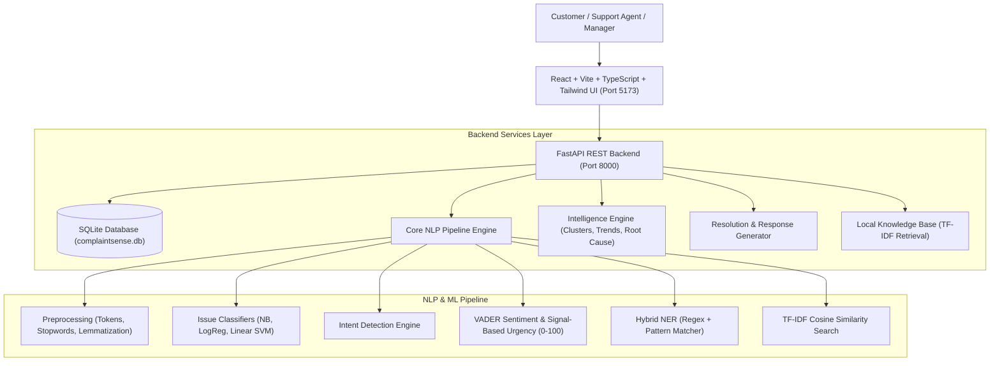

# ComplaintSense: An NLP-Based Customer Complaint Intelligence, Analysis and Resolution Platform

> **Product Tagline**: Turn customer complaints into actionable intelligence.

[](https://www.python.org/)
[](https://fastapi.tiangolo.com/)
[](https://react.dev/)
[](https://vitejs.dev/)
[](https://tailwindcss.com/)
[](https://scikit-learn.org/)
[](https://www.nltk.org/)
[](https://opensource.org/licenses/MIT)

---

## 1. Executive Summary & Vision

**ComplaintSense** is a full-stack, SaaS-architected, 100% free and local MVP designed to bridge the gap between customer support operations and executive decision-making. 

Traditional customer support systems operate on a rigid routing paradigm:
```
Customer Complaint ───► Department ───► Ticket Close
```
This conventional approach treats every complaint as an isolated transactional chore, blinding organizations to systemic operational flaws.

**ComplaintSense shifts the focus from ticket routing to Complaint Intelligence:**
```
Customer Complaint
        │
        ├──► Understand (Topic, Intent, Sentiment, Urgency Signals, NER)
        │
        ├──► Discover (Similarity, Recurring Clusters, Time Trends, Root-Cause Patterns)
        │
        └──► Act (Department Recommendation, Policy Retrieval, Human-Reviewed Response)
```

The platform answers critical business questions:
- *What is the customer actually complaining about?*
- *What does the customer want done (topic vs. underlying intent)?*
- *What is the emotional tone and urgency of the customer's language?*
- *Are there other similar complaints occurring across the company?*
- *Is this issue emerging into a trend, and what is the probable operational root cause?*
- *What does corporate policy dictate, and what empathetic response draft can assist the support agent?*

---

## 2. 100% Free & Local Architecture

ComplaintSense is built specifically to execute on a standard laptop with zero paid API subscriptions or enterprise cloud databases:
- **No Paid APIs**: No OpenAI, Anthropic, Claude, Gemini, Groq, Twilio, or WhatsApp API requirements.
- **Local Machine Learning**: Scikit-learn (Multinomial Naive Bayes, Logistic Regression, Linear SVM) and NLTK (VADER sentiment analysis, WordNet lemmatizer, tokenizers).
- **Embedded Database**: Local SQLite (`complaintsense.db`) with SQLAlchemy ORM structured with `workspace_id` for SaaS multi-tenancy.
- **Zero Cloud Vector Databases**: Semantic similarity and local knowledge retrieval are powered entirely by offline TF-IDF and cosine similarity engines.
- **No Docker Required**: Native, lightweight startup via Python virtual environments and Vite.

---

## 3. High-Level Architecture



---

## 4. Core NLP Pipeline

Every complaint ingested by ComplaintSense undergoes a transparent, explainable 10-step NLP pipeline:

```
Customer Complaint
        ↓
1. Text Preprocessing & Cleaning (HTML, URL removal, casing normalization)
        ↓
2. Tokenization, Stopwords Filtering & WordNet POS Lemmatization
        ↓
3. TF-IDF Feature Extraction (Unigrams + Bigrams, Sublinear TF)
        ↓
4. Issue Category Classification (Naive Bayes, Logistic Regression, Linear SVM)
        ↓
5. Customer Intent Detection (Topic vs Intent differentiation)
        ↓
6. VADER Sentiment Analysis & Support-Oriented Emotional Tone Classification
        ↓
7. Signal-Based Transparent Urgency Scoring (0–100: Legal, Time, Repeated, Financial, Safety)
        ↓
8. Hybrid Named Entity Recognition (ORDER_ID, MONEY, PRODUCT, LOCATION, EMAIL, PHONE)
        ↓
9. Historical Cosine Similarity Search (Top 5 matches in workspace)
        ↓
10. Local Policy Knowledge Retrieval & Context-Aware Human-in-the-Loop Response Drafting
```

---

## 5. Preconfigured Multi-Industry Demo Environments

To demonstrate generalizability, ComplaintSense ships with **4 fully populated demo company workspaces**, each containing 30–60 realistic complaints and 5 dedicated local policy documents:

| Company | Industry | Primary Complaint Categories | Sample Scenario |
| :--- | :--- | :--- | :--- |
| **ShopEase** | E-commerce | Delivery & Logistics, Billing & Refund, Product Defect, Account & Login | **Signature Demo Cluster**: Delivery delays in Mumbai linked to "SpeedFast Logistics / Express Delivery" (+35% increase). |
| **CloudDesk** | SaaS | Technical Support, Billing & Subscription, Account & Login, Legal | Gateway 504 timeouts on CSV exports, SSO SAML lockouts, and duplicate enterprise seat charges. |
| **QuickShip** | Logistics | Delivery Delays, Damaged Freight, Address Rerouting, Billing & Claims | Damaged outer cartons, highway delays, and volumetric weight disputes. |
| **ConnectTel** | Telecommunications | Network Signal, Fiber Broadband Outage, Recharge Disputes, SIM/eSIM | Blinking red LOS fiber router lights, degraded 5G cellular sites, and failed UPI recharges. |

### The Signature Demonstration Scenario (ShopEase)
In **ShopEase**, an intentional cluster of complaints highlights delayed deliveries in Mumbai fulfilled by *SpeedFast Logistics*. 
When opening the **Dashboard** or **Management Intelligence** page, the system automatically detects:
- **Emerging Issue**: Delivery Delays (+35% trend increase).
- **Possible Pattern**: Co-occurrence of *SpeedFast Logistics* shipments in *Mumbai*.
- **Most Affected Location**: *Mumbai*.
- **Recommended Action**: Audit *SpeedFast Logistics* transit times and hub sorting operations in Mumbai.

> **Methodological Note on Root Cause Analysis**: ComplaintSense transparently labels all root-cause findings as **"Possible root-cause patterns"** or **"Associated recurring factors"**. The system detects statistical and linguistic co-occurrences in customer language, avoiding unfounded causal claims.

---

## 6. Project Structure

```text
complaintsense/
├── backend/
│   ├── app/
│   │   ├── api/                  # REST API routers (workspaces, tickets, intelligence, data, etc.)
│   │   │   ├── tickets.py        # Ticket endpoints with feedback, duplicate check, tone selector
│   │   │   ├── intelligence.py   # Overview (7d/30d/90d), products, customers, trends
│   │   │   ├── knowledge.py      # Knowledge documents and automated gap detector
│   │   │   ├── evaluation.py     # Model comparisons, explainability, model health
│   │   │   └── data.py           # DB backup, CSV export, validation & bulk ingestion
│   │   ├── database/             # SQLite connection and session management
│   │   ├── models/               # SQLAlchemy ORM models (Workspace, Ticket, FeedbackRecord, etc.)
│   │   ├── repositories/         # Decoupled data access layer:
│   │   │   ├── base.py           # Generic BaseRepository with pagination & filtering
│   │   │   ├── ticket_repository.py # Ticket queries, period-over-period stats, low-confidence
│   │   │   ├── workspace_repository.py # Multi-tenant workspace management
│   │   │   ├── knowledge_repository.py # Knowledge document CRUD & search
│   │   │   └── feedback_repository.py  # Human feedback audit trail & metrics
│   │   ├── schemas/              # Pydantic request and response schemas
│   │   ├── services/             # Core business logic and NLP ticket orchestration
│   │   ├── nlp/                  # Modular NLP implementations:
│   │   │   ├── preprocessing.py  # Cleaning, tokenizing, stopwords, lemmatizing
│   │   │   ├── tfidf.py          # Vectorizer configuration and vocabulary extraction
│   │   │   ├── classification.py # Naive Bayes, Logistic Regression, Linear SVM
│   │   │   ├── explainability.py # Top TF-IDF drivers, logit contributions & rule factors
│   │   │   ├── duplicates.py     # Cosine duplicate detection engine (threshold >= 0.82)
│   │   │   ├── intent.py         # Topic vs Intent disambiguation engine
│   │   │   ├── sentiment.py      # VADER polarity & emotional tone mapping
│   │   │   ├── urgency.py        # Transparent 0-100 urgency signal engine
│   │   │   ├── ner.py            # Hybrid Named Entity Recognition
│   │   │   └── similarity.py     # TF-IDF cosine similarity search
│   │   ├── intelligence/         # Clustering, trends, root cause, product & customer risk
│   │   │   ├── products.py       # Product defect rate & return risk scoring
│   │   │   └── customers.py      # Churn risk & repeat complainant intelligence
│   │   ├── routing/              # Department recommendation mapping
│   │   ├── knowledge/            # Local TF-IDF policy retrieval & gap detector
│   │   │   ├── retriever.py      # Context-grounded policy snippet extraction
│   │   │   └── gap_detector.py   # Uncovered complaint cluster identification & SOP drafts
│   │   ├── response_generator/   # Local empathetic template response builder:
│   │   │   └── generator.py      # Multi-tone generation & real-time quality validation
│   │   └── main.py               # FastAPI entry point with CORS middleware
│   ├── tests/                    # Automated pytest suite (NLP, intelligence, API, enhancements)
│   ├── run_tests.py              # Programmatic test runner script
│   └── requirements.txt          # Python dependencies
├── frontend/
│   ├── src/
│   │   ├── api/client.ts         # TypeScript API fetch client and schema types
│   │   ├── components/           # AppLayout, Sidebar, TopBar, CsvImportModal, Modals
│   │   ├── pages/
│   │   │   ├── LandingPage.tsx   # Product landing with calm emerald theme
│   │   │   ├── OverviewPage.tsx  # Executive dashboard with 7d/30d/90d period KPIs
│   │   │   ├── ComplaintsPage.tsx# 8-column data grid, "Needs Review" filter, CSV bulk import
│   │   │   ├── ComplaintDetailPage.tsx # 3-column dossier, duplicate alert, tone variations, quality check, feedback
│   │   │   ├── IntelligencePage.tsx    # Trends, recurring issues drilldown, products & customers
│   │   │   ├── NLPLabPage.tsx          # 5-tab unified laboratory (Explain, Compare, Metrics, Pipeline, Health)
│   │   │   ├── KnowledgeBasePage.tsx   # Knowledge gap detector, SOP drafter, document browser
│   │   │   └── SettingsPage.tsx        # Profile, categories, departments, Data Operations & DB backup
│   │   ├── App.tsx               # Application routing and layout integration
│   │   ├── index.css             # Tailwind CSS directives
│   │   └── main.tsx              # React DOM root
│   ├── package.json
│   └── tsconfig.json
├── knowledge_base/               # Local policy documents across demo companies
├── models/                       # Serialized joblib classifiers and TF-IDF vectorizer
├── evaluation/                   # Saved empirical evaluation metrics (metrics.json)
├── scripts/
│   ├── train_classifier.py       # Trains Naive Bayes, Logistic Regression, Linear SVM
│   ├── evaluate_models.py        # Computes cross-validated precision, recall, F1, CM
│   └── seed_demo.py              # Seeds companies, trains models, runs NLP pipeline
├── complaintsense.db             # Local SQLite database
└── README.md
```

---

## 7. Quickstart Installation Guide

### Prerequisites
- Python 3.10+ (tested on Python 3.11, 3.12, 3.13)
- Node.js 18+ and npm

### Step 1: Clone the Repository
```bash
git clone https://github.com/aafia10/ComplaintSense.git
cd ComplaintSense
```

### Step 2: Backend Setup
```bash
cd backend

# Create dedicated virtual environment
python -m venv venv

# Activate virtual environment
# Windows:
venv\Scripts\activate
# macOS/Linux:
# source venv/bin/activate

# Install dependencies
pip install -r requirements.txt
```

### Step 3: Seed Demo Data & Train NLP Models
From the project root:
```bash
# Windows:
backend\venv\Scripts\python scripts/seed_demo.py

# macOS/Linux:
# backend/venv/bin/python scripts/seed_demo.py
```
*This command initializes `complaintsense.db`, trains the 3 machine learning classifiers, generates evaluation metrics, and executes the complete NLP pipeline on 176+ demo records.*

### Step 4: Run the Backend Server
```bash
cd backend
# Windows:
venv\Scripts\uvicorn app.main:app --reload --port 8000
# macOS/Linux:
# venv/bin/uvicorn app.main:app --reload --port 8000
```
*The FastAPI backend will be available at: `http://localhost:8000` (Swagger docs at `/docs`).*

### Step 5: Frontend Setup & Run
Open a new terminal:
```bash
cd frontend

# Install npm packages
npm install

# Start development server
npm run dev
```
*The frontend will launch at: `http://localhost:5173`.*

---

## 8. Automated Verification & Testing

To run the automated backend test suite covering NLP modules, intelligence calculations, repositories, feedback, explainability, response quality, and API endpoints:
```bash
# From project root:
backend\venv\Scripts\python backend/run_tests.py
```
*(Or directly run `pytest tests -v` inside `backend` with the active venv).*

Expected result:
```text
============================= test session starts =============================
platform win32 -- Python 3.13.9, pytest-9.1.1, pluggy-1.6.0
collected 21 items

backend/tests/test_api.py::test_api_root PASSED                          [  4%]
backend/tests/test_api.py::test_get_workspaces PASSED                    [  9%]
backend/tests/test_api.py::test_get_dashboard_stats PASSED               [ 14%]
backend/tests/test_api.py::test_create_and_fetch_ticket PASSED           [ 19%]
backend/tests/test_api.py::test_evaluation_metrics PASSED                [ 23%]
backend/tests/test_enhancements.py::test_ticket_repository_kpis PASSED   [ 28%]
backend/tests/test_enhancements.py::test_duplicate_detection PASSED      [ 33%]
backend/tests/test_enhancements.py::test_nlp_explainability PASSED       [ 38%]
backend/tests/test_enhancements.py::test_response_tone_and_quality PASSED [ 42%]
backend/tests/test_enhancements.py::test_knowledge_gap_detector PASSED   [ 47%]
backend/tests/test_enhancements.py::test_feedback_repository PASSED      [ 52%]
backend/tests/test_intelligence.py::test_trend_calculation PASSED        [ 57%]
backend/tests/test_intelligence.py::test_period_over_period PASSED       [ 61%]
backend/tests/test_intelligence.py::test_root_cause_pattern PASSED       [ 66%]
backend/tests/test_nlp.py::test_preprocessing PASSED                     [ 71%]
backend/tests/test_nlp.py::test_sentiment_analysis PASSED                [ 76%]
backend/tests/test_nlp.py::test_urgency_signals PASSED                   [ 80%]
backend/tests/test_nlp.py::test_intent_detection PASSED                  [ 85%]
backend/tests/test_nlp.py::test_named_entity_recognition PASSED          [ 90%]
backend/tests/test_nlp.py::test_classification PASSED                    [ 95%]
backend/tests/test_nlp.py::test_similarity_search PASSED                 [100%]

====================== 21 passed in 18.35s =======================
```

To test the frontend production build:
```bash
cd frontend
npm run build
```
*(Produces a zero-error optimized bundle in `frontend/dist`).*

---

## 9. Advanced SaaS Intelligence Capabilities

ComplaintSense implements a complete enterprise SaaS intelligence workflow:

### 1. Repository Pattern & Clean Decoupled Architecture
- `BaseRepository`: Generic CRUD with pagination, ordering, and workspace scoping.
- `TicketRepository`: Specialized ticket queries, period-over-period aggregate metrics, and low-confidence filtering.
- `FeedbackRepository`: Captures human review corrections for continuous model monitoring.
- `KnowledgeRepository` & `WorkspaceRepository`: Manage policies and multi-tenant configurations.

### 2. Multi-Tone Response Generation & Real-Time Quality Check
- **4 Support Tones**: `Professional`, `Empathetic`, `Concise`, and `Formal`.
- **Response Quality Rules Engine**: Real-time evaluation verifying:
  - Greeting presence
  - Direct intent acknowledgment
  - Entity referencing (Order ID, Amount, Product)
  - Clear next steps and SLA commitments
  - Professional agent sign-off

### 3. Transparent NLP Explainability
- Top TF-IDF n-gram drivers with positive/negative logit contributions.
- Urgency score breakdown across 5 signal families (Legal, Financial, Time Pressure, Repeat, Safety).
- Intent classification trigger phrases and keyword matches.

### 4. Automated Knowledge Gap Detection
- Identifies complaint clusters that lack matching internal SOP documentation.
- One-click **"Draft SOP"** generation producing structured policy templates.

### 5. Product & Customer Risk Intelligence
- **Product Risk Index**: Calculates return risk, defect rate, and financial impact by SKU.
- **Customer Churn Risk**: Identifies repeat complainants, tracks sentiment trajectories, and flags high-risk accounts.

### 6. Data Operations & Disaster Recovery
- **One-Click SQLite Backup**: `GET /api/data/export-db` streams the database snapshot.
- **CSV Data Pipeline**: 3-step bulk ingestion modal (Upload $\to$ Validate & Preview $\to$ Batch NLP Ingestion).
- **Demo Reset**: Instant restoration of baseline demo datasets.

---

## 10. Model Evaluation & Metrics

ComplaintSense values academic honesty. Classifier metrics are generated from stratified cross-validation on real complaint text rather than fabricated placeholders.

### Cross-Validation Comparison
| Model | Accuracy | Precision (Weighted) | Recall (Weighted) | F1-Score (Weighted) |
| :--- | :---: | :---: | :---: | :---: |
| **Multinomial Naive Bayes** | 62.4% | 59.7% | 62.4% | 56.5% |
| **Logistic Regression** | 53.3% | 41.1% | 53.3% | 41.6% |
| **Linear SVM (Calibrated)** | **62.4%** | **55.5%** | **62.4%** | **55.1%** |

*Confusion matrices and class-level breakdown reports can be inspected visually on the **NLP Lab → Model Comparison / Confusion Matrix** tabs.*

---

## 11. Future SaaS Roadmap (Phase 2)

While the local MVP provides a complete, polished, functional intelligence pipeline, the architecture is designed to scale into a commercial multi-tenant SaaS:

- **Enterprise Ingestion**: Webhooks and native connectors for Zendesk, Freshdesk, Salesforce Service Cloud, and Intercom.
- **Omnichannel Support**: Inbound customer email parsing and WhatsApp Business API integration.
- **Enterprise Multi-Tenancy**: Migration from SQLite to partitioned PostgreSQL with Row-Level Security (RLS).
- **Hybrid Neural Retrieval**: Optional dense semantic vector indexing using `sentence-transformers` and local Chroma/FAISS storage.
- **Self-Hosted LLMs**: Local quantized LLM integration (e.g., via Ollama/llama.cpp) to supplement template-based response generation.

---

## 12. License

This project is licensed under the MIT License — see the [LICENSE](LICENSE) file for details.

